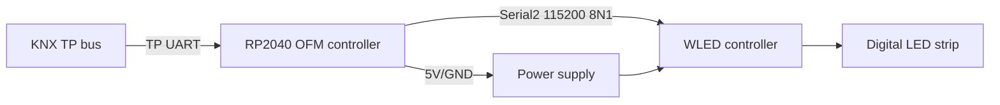

# OFM Digital LED Controller Hardware Bring-Up Guide

Until hardware is available, use CI, OpenKNXproducer, and the `test/` simulations for software validation. When the hardware is available, follow this sequence for bring-up.

## Wiring



| Function | RP2040 GPIO/interface | Connected device |
|---|---:|---|
| KNX TP TX | GPIO 0 / UART0 TX | KNX TP transceiver TX |
| KNX TP RX | GPIO 1 / UART0 RX | KNX TP transceiver RX |
| WLED TX | GPIO 4 / Serial2 TX | WLED UART RX |
| WLED RX | GPIO 5 / Serial2 RX | WLED UART TX |
| Programming LED | GPIO 2 | On-board status LED, active high |
| Programming button | GPIO 7 | Falling-edge input |
| Save interrupt | GPIO 6 | OpenKNX save signal |
| Ground | GND | Common ground for KNX transceiver and WLED |

WLED serial settings: `115200 baud, 8 data bits, no parity, 1 stop bit`. JSON frames use `CR/LF` termination.

## Flashing

```powershell
pio run -e develop_OFM_DigitalLEDController
pio run -e develop_OFM_DigitalLEDController -t upload
```

Do not upload until the target port and hardware connections have been confirmed. For a Release build:

```powershell
pio run -e release_OFM_DigitalLEDController
```

The UF2 file is located at `.pio/build/<environment>/firmware.uf2`.

## First-boot checklist

- [ ] KNX TP transceiver power, logic levels, and common ground are correct.
- [ ] WLED TX/RX are crossed correctly; do not connect 5 V directly to an RP2040 GPIO.
- [ ] The WLED firmware has its JSON serial interface enabled.
- [ ] The serial stream shows a `{"v":true}` state request after boot.
- [ ] WLED state replies update brightness, RGB, Preset, and nightlight feedback in KNX.
- [ ] The ETS application downloads successfully and its parameters match the startup defaults.
- [ ] The watchdog and programming LED do not indicate repeated resets.

## KNX Group Address test table

| Test | Object number | DPT | Expected behavior |
|---|---:|---|---|
| Switch | 201 | 1.001 | Sends WLED `on` |
| Relative dimming | 202 | 3.007 | Changes brightness by direction and step |
| Absolute brightness | 203 | 5.001 | Sends `bri`; feedback object 205 updates |
| Switch status | 204 | 1.001 | Mirrors WLED `state.on` |
| Scene | 206 | 18.001 | Maps KNX scenes 0..63 to WLED Presets 1..64 |
| RGB | 214 | 232.600 | Sends RGB and updates objects 209/211/213/215 |
| Nightlight | 216 | 1.001 | Sends `nl` using ETS duration/mode/target brightness |
| Preset | 218 | 5.001 | Selects WLED Preset 1..250 |
| Palette | 220 | 5.001 | Sets the WLED segment palette |
| Effect | 222 | 5.001 | Sets the WLED segment effect |
| Effect speed | 224 | 5.001 | Sets WLED `sx` |
| Effect intensity | 226 | 5.001 | Sets WLED `ix` |

Run the hardware-free validation first:

```powershell
python -m unittest discover -s test -p "test_*.py" -v
```

Then perform the tests in the table on the KNX bus.
