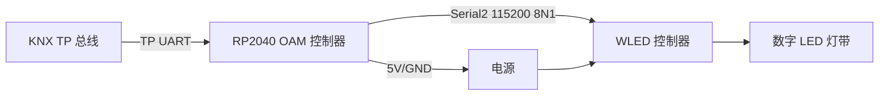

# OAM Digital LED Controller 硬件联调手册

当前没有硬件时，使用 CI、OpenKNXproducer 和 `test/` 仿真测试完成软件验证。硬件到位后按以下顺序联调。

## 接线



| 功能 | RP2040 GPIO/接口 | 连接对象 |
|---|---:|---|
| KNX TP TX | GPIO 0 / UART0 TX | KNX TP 收发器 TX |
| KNX TP RX | GPIO 1 / UART0 RX | KNX TP 收发器 RX |
| WLED TX | GPIO 4 / Serial2 TX | WLED UART RX |
| WLED RX | GPIO 5 / Serial2 RX | WLED UART TX |
| 编程 LED | GPIO 2 | 板载状态 LED，高电平点亮 |
| 编程按键 | GPIO 7 | 按下产生下降沿 |
| 保存中断 | GPIO 6 | OpenKNX 保存信号 |
| 地 | GND | KNX 收发器/WLED 共地 |

WLED 串口参数：`115200 baud, 8 data bits, no parity, 1 stop bit`。收发 JSON 帧以 `CR/LF` 结束。

## 烧录

```powershell
pio run -e develop_OAM_DigitalLEDController
pio run -e develop_OAM_DigitalLEDController -t upload
```

不要在未确认端口和硬件连接前执行上传。Release 构建：

```powershell
pio run -e release_OAM_DigitalLEDController
```

UF2 文件位于 `.pio/build/<environment>/firmware.uf2`。

## 首次启动检查清单

- [ ] KNX TP 收发器供电、电平和共地正确。
- [ ] WLED TX/RX 交叉连接，未把 5V 直接接到 RP2040 GPIO。
- [ ] WLED 固件启用 JSON 串口接口。
- [ ] 启动后串口能看到 `{"v":true}` 状态请求。
- [ ] WLED 返回状态后，亮度、RGB、Preset 和夜灯反馈进入 KNX。
- [ ] ETS 应用成功下载，参数值与启动默认值一致。
- [ ] 看门狗/编程 LED 无异常循环重启。

## KNX Group Address 测试表

| 测试 | 对象号 | DPT | 期望行为 |
|---|---:|---|---|
| 开关 | 201 | 1.001 | 发送 WLED `on` |
| 相对调光 | 202 | 3.007 | 按方向/步长改变亮度 |
| 绝对亮度 | 203 | 5.001 | 发送 `bri`，反馈对象 205 更新 |
| 开关状态 | 204 | 1.001 | 返回 WLED `state.on` |
| 场景 | 206 | 18.001 | KNX 场景 0..63 映射 WLED Preset 1..64 |
| RGB | 214 | 232.600 | 发送三通道颜色并同步 209/211/213/215 |
| 夜灯 | 216 | 1.001 | 使用 ETS 时长/模式/目标亮度发送 `nl` |
| Preset | 218 | 5.001 | 选择 WLED Preset 1..250 |
| Palette | 220 | 5.001 | 设置 WLED segment palette |
| Effect | 222 | 5.001 | 设置 WLED segment effect |
| Effect Speed | 224 | 5.001 | 设置 WLED `sx` |
| Effect Intensity | 226 | 5.001 | 设置 WLED `ix` |

先使用 `python -m unittest discover -s test -p "test_*.py" -v` 完成无硬件验证，再进行这张表的总线实测。
